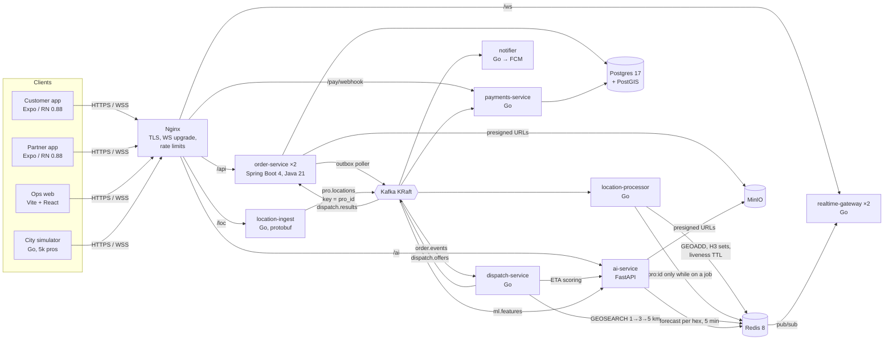
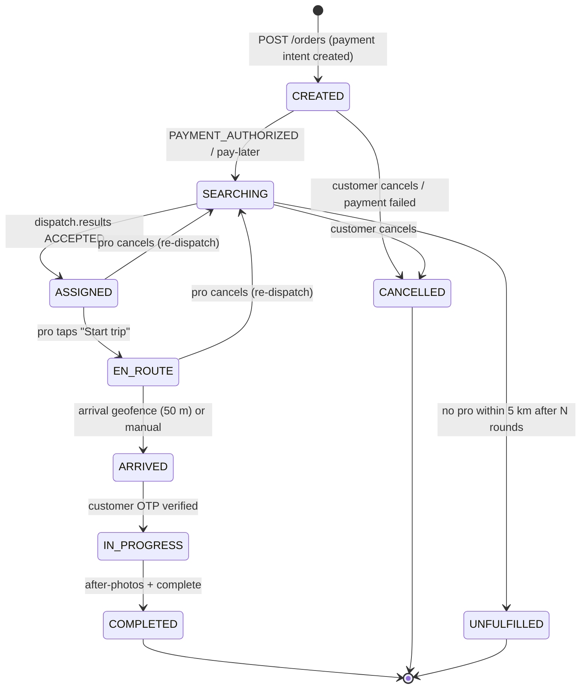
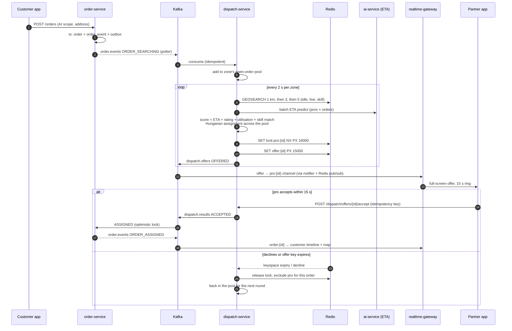
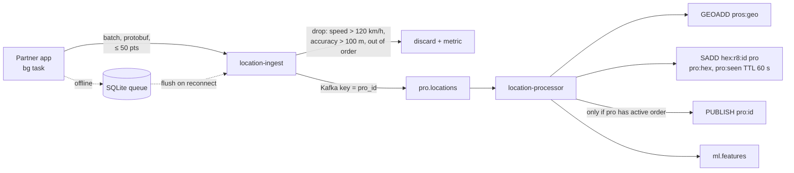
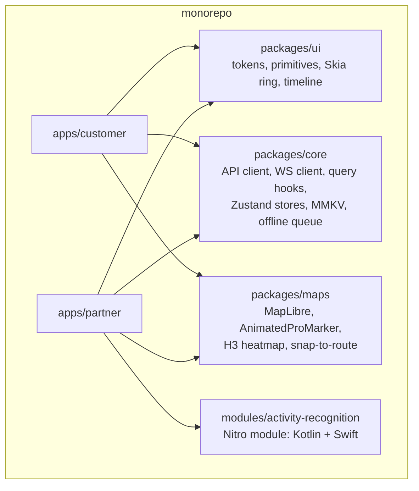

# Fixr architecture

Fixr is a two-sided marketplace that gets a verified pro to a customer's door in 10 to 15 minutes. It has two React Native apps (Customer and Partner), one event-driven backend and a city simulator that drives that backend through its public APIs.

## 1. System

| Service | Language | Owns | Why that language |
|---|---|---|---|
| order-service | Java 21, Spring Boot 4 | users, OTP and JWT auth, catalogue, addresses, zones, orders, outbox, ratings, media metadata, invoices, support tickets | rich domain model, JPA optimistic locking, transactions around outbox writes |
| location-ingest | Go | nothing (stateless) | hot path: thousands of points per second, small memory |
| location-processor | Go | Redis GEO + H3 membership | same reason |
| dispatch-service | Go | dispatch_offers, matching loop | tight 2 s loop, Hungarian solver, Redis locks |
| realtime-gateway | Go | WebSocket sessions | about 10 KB per connection, goroutine per socket |
| payments-service | Go | payments, ledger_entries | small, webhook-driven |
| notifier | Go | nothing (stateless) | Kafka to FCM fan-out |
| ai-service | Python, FastAPI | ML models, LLM calls, forecast worker | LightGBM, h3, LLM SDKs |

All Go services share one module (`services/go`) with one binary per `cmd/`, so the protobuf types, Kafka client and auth code are shared.

## 2. Order state machine

- Transitions live in one table (`OrderStateMachine.ALLOWED`). Any other transition returns `409 ILLEGAL_TRANSITION`.
- `orders.version` is a JPA `@Version` column, so a transition that races another fails with `409 STALE_ORDER` and the client refetches.
- Each transition writes `orders`, `order_events` and `outbox` in one transaction. A poller (`SELECT ... FOR UPDATE SKIP LOCKED`, 200 ms) publishes `outbox` rows to `order.events`, keyed by `order_id`, and marks them sent. It delivers at least once. Consumers dedupe on `processed_events(consumer, event_id)`.

## 3. Dispatch sequence

## 4. Location pipeline

- Points are partitioned by `pro_id`, so each pro's points are processed in order.
- `pro:seen:{id}` has a 60 s TTL. A pro whose key expired is treated as offline by dispatch, whatever the app says.
- Fan-out control: a location update goes to the `pro:{id}` pub/sub channel only while that pro has an active job (`active:pro:{id}` set by the order consumer). Idle pros update only the GEO/H3 indices, which keeps gateway traffic proportional to live jobs rather than online pros.

## 5. Realtime gateway

- One WebSocket per app. The client sends `{"op":"sub","ch":"order:123"}` and the gateway checks the channel against JWT claims: customers get `order:{own}`, pros get `pro:{self}` and `offer:{self}`, everyone gets `hex:*`, ops gets everything.
- Every frame carries `seq`, a per-channel sequence from a Redis Stream (`XADD ch:{name} MAXLEN ~ 200`). On reconnect the client sends `{"op":"resume","ch":...,"after":seq}` and the gateway replays from the stream, so no node needs sticky sessions.
- Backpressure: each socket has a bounded send queue. Location frames are coalesced per channel (only the latest is kept). State frames are never dropped. A socket that falls behind 256 frames is closed with code 4008 and the client reconnects with resume.
- Client reconnect: exponential backoff (0.5 s to 30 s) with full jitter, paused while the app is in the background and resumed on `AppState` active.

## 6. Mobile architecture

- **Maps**: MapLibre RN v11 with OpenFreeMap vector tiles, so no Google Maps key is needed. The pro marker is a `MarkerView` whose position is a Reanimated shared value. Each GPS fix starts a `withTiming` from the current point to the new one over the gap between fixes, and the bearing rotates along the shortest arc. A fix within 30 m of the route polyline is projected onto it.
- **Heatmap**: `h3-js` turns the visible bbox into r8 cells (`polygonToCells`). One `ShapeSource` holds the polygons and the fill colour is a data-driven expression on `feature-state`, so a WebSocket update changes one feature's state without rebuilding the GeoJSON.
- **Background location**: an `expo-task-manager` task with an Android foreground service. A state machine (`EN_ROUTE` 3 s, `ON_JOB` 15 s, `IDLE` 30 s, `STATIONARY` paused) is driven by job state plus the Nitro `ActivityRecognition` module (still, walking or vehicle). Points go into an `expo-sqlite` queue and are flushed in batches of up to 50.
- **Offline actions**: arrive, start, complete and photo upload are queued with a client UUID as `Idempotency-Key` and replayed strictly in order. The server stores `(key, response)` for 24 h, so a replay returns the original response.
- **State**: TanStack Query for server state (with optimistic updates on add-ons and ratings), Zustand for session and UI, MMKV as the persister for both.

## 7. Data model

Postgres tables: `users`, `otp_challenges`, `pros`, `pro_skills`, `pro_documents`, `zones` (PostGIS `geometry(Polygon,4326)`), `addresses`, `services`, `orders`, `order_events`, `outbox`, `processed_events`, `idempotency_keys`, `dispatch_offers`, `payments`, `ledger_entries`, `ratings`, `media`, `support_tickets`, `consents`.

Redis keys: `pros:geo` (GEO), `hex:r8:{cell}` (set), `pro:hex:{id}`, `pro:seen:{id}` (TTL 60 s), `pro:state:{id}` (hash: online, skills, rating, jobs today), `lock:pro:{id}`, `offer:{id}`, `active:pro:{id}`, `forecast:{cell}`, streams `ch:{channel}`.

Kafka topics (6 partitions each, keyed as noted): `order.events` (order_id), `pro.locations` (pro_id), `dispatch.offers` (pro_id), `dispatch.results` (order_id), `payments.events` (order_id), `notifications.out` (user_id), `ml.features` (order_id).

## 8. AI service

| Endpoint | What it does | Model |
|---|---|---|
| `POST /ai/scope` | photo, video frame or text in; a `JobScope` JSON out | multimodal LLM behind a `LLMProvider` interface (Claude by default, Groq second, deterministic rules if neither key is set) |
| `POST /ai/stt` | audio in, Hinglish transcript out | Whisper-compatible endpoint |
| `POST /ai/eta` | batch of (pro, order) features in; ETA and duration p50/p90 out | LightGBM quantile models trained on simulator history |
| `POST /ai/support` | tool-calling copilot | LLM with tools `get_order`, `get_pro_location`, `reschedule`, `raise_ticket` |
| `POST /ai/quality` | before and after photos in; verdict and confidence out | vision LLM |
| worker | demand forecast per r8 hex for the next 60 min, every 5 min | seasonal baseline + LightGBM on recent counts |

`JobScope` is validated with Pydantic. An invalid reply is retried once with the validation error fed back. If confidence is below 0.6, the app falls back to the manual category picker.

## 9. Observability

OpenTelemetry SDKs in every service export to an OTel Collector, which sends traces to Jaeger and metrics to Prometheus. Grafana shows orders/min, time-to-assign p50/p95, Kafka consumer lag, active pros, WebSocket connections and location points/sec. Mobile apps report to Sentry (DSN optional) and send custom metrics (location batch success rate, WS reconnects, time to first assignment) to `POST /api/telemetry`.

## 10. Local resource budget

The dev machine gives Docker 4 GB, so the compose file caps memory: Kafka 640 MB (heap 384 MB), Postgres 256 MB, Redis 192 MB, MinIO 192 MB, order-service ×2 at 448 MB each, ai-service 384 MB, Go services 64 MB each, and Prometheus, Grafana, Jaeger and the collector at 128 MB each. Observability is a compose profile (`--profile obs`) so the core stack fits on its own.
